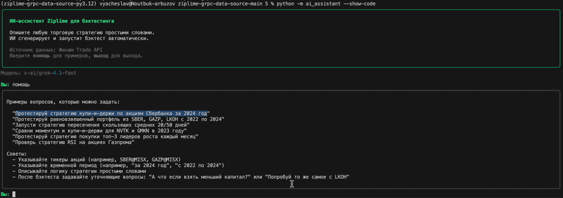

адаптер [Ziplime](https://github.com/Limex-com/ziplime) для Финам Trade API. Бэктестинг на MOEX без боли.

> Потому что `yfinance` тут не поможет.

---

## Что это

**ZipFinam** — инструмент для тестирования торговых стратегий на российском рынке.

Просто опишите стратегию словами на русском — встроенный **ИИ-ассистент** сам напишет код и запустит бэктест. Программирование не нужно. Иногда.

---

## ИИ-ассистент



Самый простой способ начать — через ИИ-ассистента. Вы пишете, что хотите проверить, он делает остальное.

### Установка

```bash
pip install zipfinam
```

### Настройка

Создайте файл `.env` в папке проекта:

```env
GRPC_TOKEN=ваш_jwt_токен_финам
GRPC_SERVER_URL=api.finam.ru:443
OPENROUTER_API_KEY=ваш_ключ_openrouter
```

- **Токен Финам** — выдаётся в личном кабинете брокера на сайте [API Финама](https://api.finam.ru)
- **Ключ OpenRouter** — бесплатная регистрация на [openrouter.ai](https://openrouter.ai), есть бесплатные модели

### Запуск

```bash
python -m ai_assistant
```

### Примеры запросов

Просто напишите в чат на русском языке:

```
Протестируй стратегию купи-и-держи по акциям Сбербанка за 2024 год
Запусти равновзвешенный портфель из SBER, GAZP, LKOH, GMKN с 2022 по 2024
Проверь стратегию пересечения скользящих средних 20/50 на акциях Газпрома
Сравни моментум и купи-и-держи для NVTK и GMKN в 2023 году
```

### Команды в чате

| Команда    | Действие                  |
|------------|---------------------------|
| `помощь`   | Показать примеры запросов |
| `очистить` | Сбросить историю разговора |
| `выход`    | Выйти из программы        |

### Параметры запуска

```bash
# Интерактивный выбор модели
python -m ai_assistant

# Запустить сразу без выбора модели
python -m ai_assistant --default-model

# Показывать сгенерированный код стратегии
python -m ai_assistant --show-code
```

### Доступные модели

При запуске отображается меню выбора модели:

| Категория | Модели |
|-----------|--------|
| **Бесплатные** | `nvidia/nemotron-3-super-120b-a12b:free`, `qwen/qwen3-next-80b-a3b-instruct:free`, `z-ai/glm-4.5-air:free` *(по умолчанию)*, `stepfun/step-3.5-flash:free` |
| **Платные (РФ)** | `deepseek/deepseek-v3.2`, `xiaomi/mimo-v2-flash`, `qwen/qwen3-coder-next`, `z-ai/glm-5`, `moonshotai/kimi-k2.5` |
| **Платные (не РФ)** | `google/gemini-3.1-flash-lite-preview`, `x-ai/grok-code-fast-1`, `openai/gpt-5-mini` |

Модель (любую с openrouter) можно задать через переменную окружения (тогда меню пропускается):
```bash
export OPENROUTER_MODEL=deepseek/deepseek-v3.2
```

---

## Для разработчиков

Если вы хотите загружать данные и запускать стратегии вручную — читайте дальше.

### Загрузка исторических данных

```python
import asyncio
from ziplime_grpc_data_source import GrpcDataSource

data_source = GrpcDataSource(
    grpc_token="ваш_токен",
    grpc_server_url="api.finam.ru:443",
)

# Загрузка данных по акциям Сбербанка и Газпрома
asyncio.run(data_source.ingest(
    symbols=["SBER@MISX", "GAZP@MISX"],
    start="2024-01-01",
    end="2025-01-01",
))
```

### Загрузка каталога активов

```python
import asyncio
from ziplime_grpc_data_source import FinamAssetDataSource

asset_source = FinamAssetDataSource(
    authorization_token="ваш_токен",
    server_url="api.finam.ru:443",
)

asyncio.run(asset_source.ingest())
```

### Отчёты в нескольких валютах

Пример [examples/currencies/run_simulation_grpc.py](examples/currencies/run_simulation_grpc.py)
запускает одну стратегию покупки SBER с начальным капиталом **100 000 RUB** и строит
независимые отчёты в **RUB и USD** через `CurrencyReporting`. Покупка акций и комиссии
остаются в RUB. Переоценка в USD учитывает изменение курса, поэтому доходности в двух
валютах могут различаться. Бенчмарк SBER также пересчитывается в валюту отчёта.

Нужна версия ziplime с новой поддержкой `CurrencyReporting` и
`CurrencyConversionService`. Для работы с соседним checkout из корня zipFinam:

```bash
python -m pip install -e ../ziplime
```

Пример использует уже сохранённые каталог инструментов и дневные котировки SBER
и выбранного USD/RUB-листинга. По умолчанию данные читаются из пакета
`grpc_daily_data` в `~/.ziplime/data`, каталог инструментов — из
`~/.ziplime/assets.sqlite`. Для запуска нужны готовые локальные данные:

```bash
python -m examples.currencies.run_simulation_grpc

# Другой период и конкретный валютный инструмент из каталога Финам
python -m examples.currencies.run_simulation_grpc \
  --start 2025-09-02 --end 2025-09-17 --fx-symbol 'USDRUB@_NPRO'
```

Для FX выбирается точный листинг `ticker@MIC`: по умолчанию `USDRUB@_NPRO`.
Он должен быть доступен в вашем каталоге и иметь котировки за нужный период.
Направление конвертации определяется полями валют в каталоге, а не разбором тикера;
обратный курс RUB → USD рассчитывается автоматически.

Временные метки FX-данных должны отражать доступность курса и нормализоваться при
загрузке данных. Пример использует сохранённый `date` без сдвига на следующий день:
для добавленных справочных курсов ЦБ это дата действия курса. Для рыночного дневного
close при загрузке нужно указать время, когда цена закрытия стала известна.
`CurrencyConversionService.from_bundle()` читает запас истории для начальной оценки
и проверяет котировки; пропущенные, некорректные и устаревшие значения вызывают ошибку.
Максимальный возраст доступного курса — семь дней.

Результат доступен в `result.perf_by_currency["RUB"]` и
`result.perf_by_currency["USD"]`, а `result.perf` сохраняет базовый отчёт в RUB.
Скрипт выводит последние строки и сохраняет ежедневные показатели в
`currency_reports/performance_RUB.csv` и `currency_reports/performance_USD.csv`.
`pnl` — изменение за день, `returns` — дневная доходность в долях единицы,
`algorithm_period_return` и `benchmark_period_return` — накопленная доходность.
Для другого пакета, каталога данных или отчётов используйте `--bundle`,
`--ziplime-dir` и `--output-dir`.

---

## Возможности

- **Интеграция с Финам Trade API** — прямое подключение к данным российских ценных бумаг
- **Исторические котировки** — загрузка OHLCV-данных в таймфреймах от M1 до MN (месяц)
- **Каталог активов** — получение списка инструментов и бирж с маппингом тикеров
- **Асинхронная архитектура** — параллельная загрузка данных через пул потоков
- **ИИ-ассистент** — создание и запуск бэктестов по описанию стратегии на русском языке
- **Автоматическая установка базы данных** — файл `assets.sqlite` копируется в `~/.ziplime/` при первом импорте пакета

---

## Поддерживаемые таймфреймы

| Код    | Описание        |
|--------|-----------------|
| `M1`   | 1 минута        |
| `M5`   | 5 минут         |
| `M15`  | 15 минут        |
| `M30`  | 30 минут        |
| `H1`   | 1 час           |
| `H2`   | 2 часа          |
| `H4`   | 4 часа          |
| `H8`   | 8 часов         |
| `D`    | День            |
| `W`    | Неделя          |
| `MN`   | Месяц           |

---

## Примеры

В папке `examples/` находятся готовые скрипты:

- `ingest_assets_data_grpc.py` — загрузка каталога активов
- `ingest_data_grpc.py` — загрузка исторических котировок (SBER, UGLD, UKUZ, WUSH)
- `run_simulation_daily_grpc.py` — запуск дневной симуляции
- `currencies/run_simulation_grpc.py` — одна симуляция с отчётами в RUB и USD
- `algorithms/test_algo/test_algo.py` — пример алгоритма равновзвешенного портфеля

---

## Структура проекта

```
ziplime_grpc_data_source/
├── grpc_data_source.py        # Загрузка исторических данных из gRPC
├── grpc_asset_data_source.py  # Загрузка активов и бирж из gRPC
├── assets.sqlite              # База данных активов (копируется в ~/.ziplime/)
└── grpc_stubs/                # Сгенерированные Protocol Buffer стабы
    └── grpc/tradeapi/v1/
        ├── auth/              # Сервис аутентификации
        ├── assets/            # Сервис активов
        ├── accounts/          # Сервис счетов
        ├── marketdata/        # Сервис рыночных данных
        └── orders/            # Сервис ордеров

ai_assistant/
├── agent.py                   # LLM-агент (OpenRouter)
├── cli.py                     # Интерактивный CLI на русском языке
├── data_manager.py            # Управление данными Финам API
├── executor.py                # Запуск бэктестов
└── prompts.py                 # Системные промпты на русском языке
```

---

## Зависимости

- Python >= 3.12
- [ziplime](https://github.com/Limex-com/ziplime) >= 1.11.11
- grpcio >= 1.76.0
- googleapis-common-protos >= 1.72.0

Для ИИ-ассистента дополнительно:
- openai >= 1.0.0 (клиент OpenRouter)
- rich >= 13.0.0
- python-dotenv >= 1.0.0
- quantstats >= 0.0.81 (HTML-отчёты по стратегиям)

---

## Лицензия

Apache License 2.0
